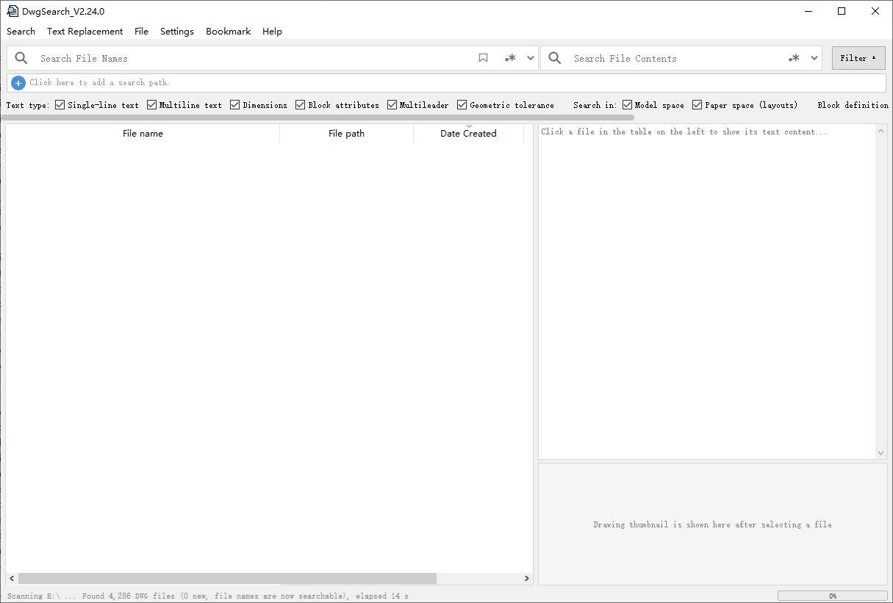
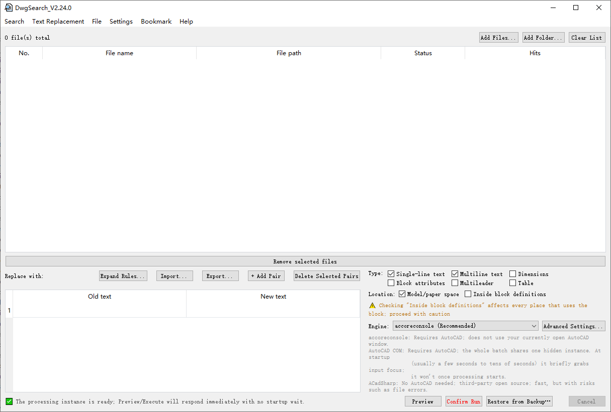

# DwgSearch

> **A desktop tool for batch searching & replacing text in DWG drawings**  
> Local indexing enables fast search by filename or drawing text content (supports regular expressions).

---

## 📥 Download

| Version | Type | Use Case |
|---------|------|----------|
| **[Portable (Auto-redirects to latest)](https://github.com/DwgSearch/DwgSearch/releases/latest)** | `.zip` (single-folder mode) | No install, green run, works on Win7/10/11 |

**Slower download in China?** Use the domestic mirror: **[Gitee Releases](https://gitee.com/h1985/DwgSearch/releases)** (latest version always on top)

The software has a built-in **"Help → Check for Updates"** feature that checks for new versions on startup and shows a small red dot on the menu item when an update is available.

---

## ✨ Core Features

| Feature | Description |
|---------|-------------|
| **Full-text Search** | Indexes text inside DWG drawings (model space, paper space, block definitions, attribute blocks) |
| **Filename Search** | Supports wildcards `*` (any chars) `?` (single char), e.g. `N-3*Assembly`; also supports regex; case-insensitive |
| **Drawing Thumbnail** | Displays embedded DWG preview image in preview pane, no CAD required |
| **Batch Replace** | Three engines (accoreconsole / AutoCAD COM / ACadSharp), with preview, auto-backup, fine-grained control over entity types & locations |
| **Right-click Integration** | Enable in Settings → "Integrate into right-click menu", then right-click any folder in Explorer → "Search with DwgSearch" |
| **Bookmarks** | One-click save frequently used "filename + content" search conditions |
| **Multi-window** | `Ctrl+Shift+N` opens independent window, shares same background index |
| **System Tray** | Close window minimizes to tray, background indexing continues |
| **Replace Backup / Restore** | Auto-backup before replace, one-click restore by batch; index database location customizable |

---

## 🖼️ UI Preview

### Main Window - Search & Indexing

### Batch Replace Page

---

## 🖥️ System Requirements

| Component | Requirement |
|-----------|-------------|
| **OS** | Windows 7 SP1 / 8 / 10 / 11 (x64) |
| **.NET Runtime** | .NET Framework 4.8 required (Win7: manual install; Win10/11: usually pre-installed) |

---

## 🚀 Quick Start

1. Download and extract the portable zip to any folder (e.g. `D:\Tools\DwgSearch`)
2. Double-click `DwgSearch.exe` to run
3. On first launch, the app auto-indexes all local fixed drives in background (status bar shows "Background indexing..."). You can search immediately — results may just be incomplete until indexing finishes
4. Want to search only specific folders? Click "+" on the search scope bar to add folders and check them (none checked = search all). Network drives / USB drives are not auto-scanned; add & check them to prioritize indexing

---

## 📖 User Guide

### Search
- **Filename** and **Content** fields can be used independently or together (auto AND logic)
- Multiple keywords separated by space (all must match); each keyword ≥ 2 chars; case-insensitive
- Filename supports wildcards: `*` = any chars, `?` = exactly one char; matches anywhere in filename (e.g. `drawing?.dwg`, `M-12*UHF*01`); content search does **not** support wildcards
- Regex supported (click `.*` icon next to search box); result columns configurable (path / date / DWG version / size, etc.)

### Batch Replace
1. Toggle between **Search** and **Replace** pages via top toolbar; switching away won't interrupt a running replace job
2. Two ways to start: open Replace page & add files manually, **or** select rows in search results → right-click "Replace Selected" to carry them over
3. Fill "Old Text → New Text" (multiple pairs supported), check entity types (Text / MText / Dimension / Block Attribute) and spaces (Model / Paper / Block Definitions)
4. Click **Preview** to verify matches → **Execute**
5. Original files are auto-backed up before replace; restored via "Restore from Backup" after execution

---

## 🔒 License & Disclaimer

**Binary-only distribution. Source code is not public.**

- ✅ Allowed: Free download, personal/commercial use, sharing via original Release page link
- ❌ Forbidden: Decompilation, reverse engineering, binary modification, copyright/watermark removal, repackaging & redistribution
- ⚠️ Provided "as is", no liability for any direct/indirect damages
- 📄 Full terms in [LICENSE](LICENSE) / Release page "License" section

---

## 🛡️ Security Notes

- **Code signing**: No EV certificate yet; SmartScreen may warn "Unrecognized app" — click "More info" → "Run anyway"
- **AV false positives**: PyInstaller folder-mode bundles are prone to heuristic false positives; verify on [VirusTotal](https://www.virustotal.com/)

---

## 🐛 Feedback & Support

| Channel | Description |
|---------|-------------|
| **GitHub Issues** | [Submit Bug / Feature Request](https://github.com/DwgSearch/DwgSearch/issues) |
| **Gitee Issues** | [Domestic mirror feedback](https://gitee.com/h1985/DwgSearch/issues) |
| **Email** | `378600950@qq.com` (for non-public security/privacy issues only) |

---

## 🙏 Acknowledgments

- [ACadSharp](https://github.com/ACadSharp/ACadSharp) — Pure .NET DWG/DXF library
- [PyInstaller](https://pyinstaller.org/) — Python packaging
- [PyQt5](https://www.riverbankcomputing.com/software/pyqt/) — GUI framework

---

## 📞 Contact

- **Home**: [GitHub](https://github.com/DwgSearch/DwgSearch) | [Gitee](https://gitee.com/h1985/DwgSearch)
- **Email**: 378600950@qq.com

---

## 💴 Sponsor

> **If this tool saves you time, consider sponsoring! — Completely optional, no features locked.**

 

---

## ⭐ Star History

> **Easiest way to support: click the ⭐ at the top of the page**

---

## 🌐 Language

- **English** (this file)
- [中文文档](README.md)